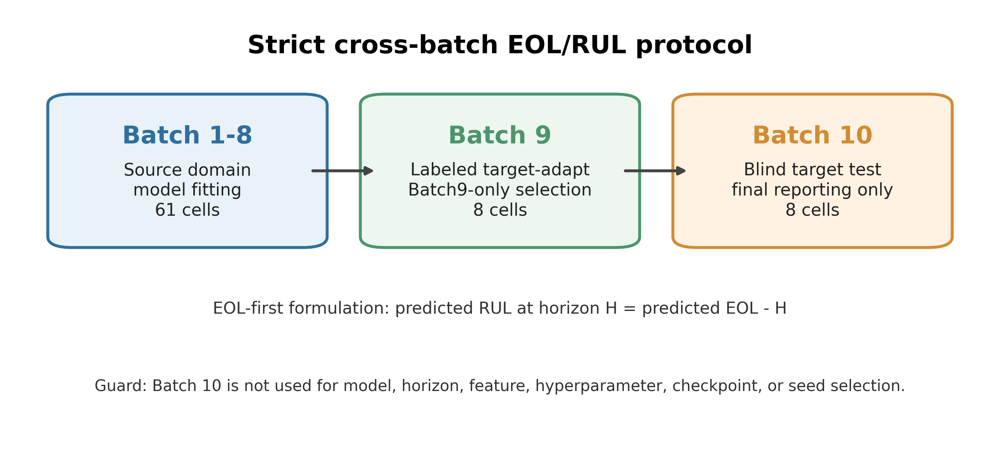
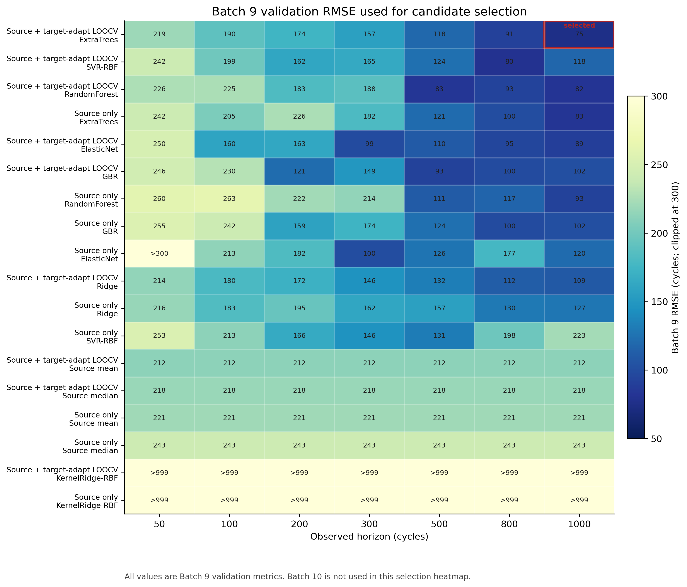
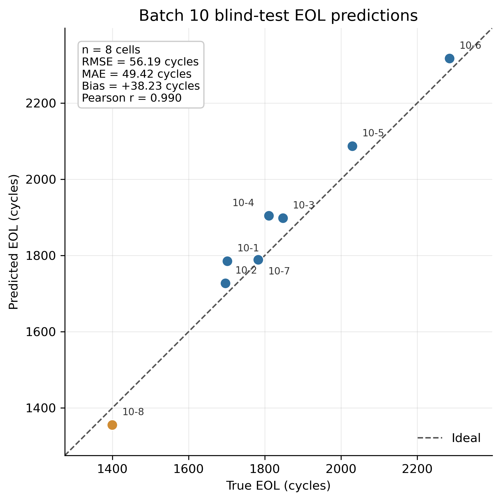
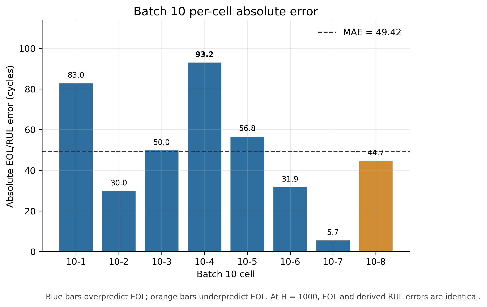

# Protocol-Clean Early-to-Mid-Life EOL/RUL Prognostics for Lithium-Ion Batteries under Small Labeled Target-Domain Adaptation

Author 1, Author 2, Author 3*  
School/Institute, University, City, Postal Code, China  
*Corresponding author: Name (email@domain.com).

## Abstract

锂离子电池寿命预测是电池管理、质保评估、梯次利用筛选与运维决策中的关键问题。实际工程场景中，新生产批次或新目标域通常只有少量已经完成全寿命老化的电池，完整 EOL 标签获取周期长，而寿命风险评估又需要在退化早中期提前完成。针对这一矛盾，本文面向跨批次小样本目标域条件，构建了一种协议洁净的早中期 EOL/RUL 联合预后框架。

本文将 RUL 预测表述为 EOL-first 问题。根据已审计数据结构，同一电池在任一观测循环处的 RUL 满足 RUL = EOL cycle - current cycle。因此，模型首先基于固定观测 horizon 之前的历史容量/SOH 摘要和退化曲线指纹预测电池级 EOL，再由 predicted RUL = predicted EOL - current cycle 得到 RUL。该定义将点级 RUL 与电池级寿命终点绑定，避免了独立 RUL 回归可能产生的终点不一致问题。

在实验协议上，Batch 1-8 被固定为源域，Batch 9 作为带标签目标域开发/自适应集合，Batch 10 仅用于最终盲测。候选模型、特征族与观测 horizon 均只允许依据 Batch 9 验证结果选择，Batch 10 不参与任何训练、调参、特征筛选或模型选择。由于 Batch 9 EOL 标签被用于目标域自适应，本文明确将任务定义为 supervised small labeled target-domain adaptation，而不是无监督域适应。

在严格协议下，Batch-9-only 选择得到 source_plus_target_adapt_LOOCV + ExtraTrees + 1000 cycles 的当前主结果。该模型在 Batch 9 上获得 RMSE/MAE 为 75.26/61.96 cycles，在 8 个 Batch 10 盲测电池上获得 EOL/RUL RMSE/MAE 为 56.19/49.42 cycles，最大绝对误差为 93.21 cycles。目标域标签预算实验进一步表明，当 Batch 9 可用标签数 k 从 0 增加至 8 时，Batch 10 平均 RMSE 从 64.27 cycles 降至 56.19 cycles。

为增强审稿防御，本文补充进行了 Batch-9-only 特征族与观测窗口审计、端点泄漏负向控制、原始 pkl 特征溯源以及物理一致性神经原型诊断。结果表明，融合历史容量/SOH 摘要与观测窗口内曲线退化指纹的 processed feature family 在 Batch 9 验证中优于单独 SOH/capacity 或 curve fingerprint 特征族；若人为注入由真实 EOL 派生的 observed-ratio 或 remaining-cycle 字段，验证误差会非正常塌缩，从反面说明端点相关变量必须被显式排除。两个严格神经原型均未超过 ExtraTrees 主基线，因此本文将其作为诊断性负结果而非新的主模型。

## Keyword

Lithium-ion battery; Remaining useful life; End-of-life prediction; Cross-batch adaptation; Small labeled target domain; Leakage control; Degradation fingerprint

## 1 Introduction

锂离子电池作为电动汽车、储能电站和便携式电子设备中的核心储能单元，其健康状态和剩余寿命直接影响系统安全性、经济性与调度策略。随着电池系统从实验室测试走向规模化工程部署，运维人员不仅需要知道当前 SOH，还需要提前判断电池距离失效终点还有多少可用循环，从而支撑质保、退役、梯次利用与风险预警等决策 [1,6,14]。

然而，电池 RUL 预测在实际落地中面临一个典型工程痛点：目标批次数据少、全寿命标签慢、跨批次分布偏移明显。新生产批次往往只能获得少量已经跑到 EOL 的样本，而其余样本仍处于早中期循环阶段。如果完全等待目标批次全部电池达到失效阈值，预测模型将失去提前决策价值；如果直接使用旧批次训练模型，又可能因为制造批次、测试条件和退化路径差异导致泛化性能下降 [2,3,9,15]。

现有 SOH 或 RUL 研究中，深度学习、迁移学习、半监督学习和物理信息机器学习已被广泛用于提高预测精度和降低标签需求 [1-5,7,11,13,15,19]。但不同文献之间常存在数据集、观测窗口、目标定义、划分协议和指标单位不一致的问题。若未严格区分 battery-level split 与 sample-level split，同一电池的不同循环样本还可能混入训练和测试而形成身份泄露 [20]。因此，单纯追求模型名称或网络复杂度，并不能直接构成可被审稿人接受的寿命预测证据。

本文当前工作的出发点不是提出一个复杂神经网络，而是先建立一个可以经受审稿人检查的任务协议：源域、目标域开发集和最终盲测集必须固定；Batch 10 不能参与任何选择；所有输入特征必须来自观测 horizon 之前；EOL、RUL、全寿命长度、观测比例、cell/batch 标识等潜在泄露字段必须显式排除。只有在这个基础上，后续的物理一致性约束、域自适应模块或不确定性估计才具有可信的评价基础。

本文主要贡献包括以下四点：

(1) 面向跨批次小样本目标域场景，构建了 Batch 1-8 源域、Batch 9 带标签目标域开发/自适应、Batch 10 盲测的固定协议，明确避免 Batch 10 参与模型选择。

(2) 提出 EOL-first RUL 预测表述，将 RUL 定义为 predicted EOL 与 current cycle 的差值，使电池级寿命终点和点级剩余寿命保持一致。

(3) 建立特征可用性与泄露控制流程，保留历史容量/SOH 摘要和观测 horizon 内退化曲线指纹，排除 EOL/RUL 标签、全寿命长度、观测比例和身份标识等不可用字段。

(4) 补充 Batch-9-only 特征族/窗口审计、泄漏负向控制、目标域标签预算、原始 pkl 溯源和神经负向控制，形成可复核的审稿防御证据链。

## 2 Related Works

### 2.1 Data-driven Battery SOH and RUL Prediction

数据驱动电池寿命预测通常利用容量曲线、电压/电流曲线、增量容量特征、差分容量特征或深度时序表示对 SOH、EOL 或 RUL 进行估计。近年来，ANN、CNN、LSTM、TCN、Transformer、注意力机制以及分解-预测融合模型被广泛用于 RUL 预测 [1,4,5,10,12]。这些方法证明了深度模型在非线性退化建模中的潜力，但其性能依赖于输入窗口、训练样本规模、划分方式和指标定义。

### 2.2 Transfer Learning and Small Target-Domain Prognostics

当目标域标签稀缺时，迁移学习、半监督学习和域自适应成为电池健康预测的重要方向。已有研究通过 MMD 分布对齐、半监督一致性正则、深度迁移微调或表示学习减少目标域标签需求 [2,3,9,15]。这些方法与本文工程动机一致，即希望在目标批次标签不足时提升模型适应能力。需要强调的是，本文当前协议使用 Batch 9 的 EOL 标签进行目标域自适应，因此属于带标签小样本目标域自适应，而不是无监督域适应或 target-label-free transfer。

### 2.3 Physics-informed and Consistency-constrained Prognostics

物理信息机器学习为电池寿命预测提供了另一条重要路径。相关研究将充电曲线参数、电化学/热模型、SEI 衰退机理、贝叶斯不确定性或物理约束损失嵌入模型中，从而提高可解释性和小样本泛化能力 [7,8,13,16,19]。本文当前可合理声称的物理一致性来自 EOL-first 标签结构和补充的低阶退化基座诊断，而不是一个已经超过基线的物理信息神经网络。

## 3 Methodology

### 3.1 Overview

本文框架如 Fig.1 所示。首先，从每个电池的历史循环中截取不超过固定 horizon 的观测片段；其次，构建历史容量/SOH 摘要与退化曲线指纹；然后，在 Batch 1-8 源域和 Batch 9 带标签目标域上训练 EOL 预测模型，并通过 Batch 9 leave-one-target-cell-out 验证选择模型与 horizon；最后，将固定模型一次性应用于 Batch 10 盲测电池，并由 predicted RUL = predicted EOL - current cycle 生成剩余寿命预测。

**Fig.1 Strict cross-batch protocol and leakage guard.**

**Table 1 Fixed data split and permitted use.**

| Role | Batches | Cells | Allowed use |
| --- | --- | --- | --- |
| Source domain | Batch 1-8 | 61 | Source training and source-only comparator |
| Target development/adaptation | Batch 9 | 8 | Labeled target adaptation and Batch-9-only selection |
| Blind target test | Batch 10 | 8 | Final reporting only; no training or selection |

### 3.2 EOL-first RUL Formulation

设第 i 个电池的真实寿命终点为 E_i，当前观测循环为 c。对于当前数据集，审计结果表明同一电池内 cycle + rul_cycle 保持常数，因此 RUL 可表示为 RUL_i(c) = E_i - c。模型目标不是直接学习互相独立的点级 RUL，而是学习从历史观测 H_i(<=c) 到电池级寿命终点的映射 predicted E_i = f(H_i(<=c))。随后，任一循环点的 RUL 由 predicted RUL_i(c) = predicted E_i - c 得到。

### 3.3 Cross-batch Small Labeled Target-domain Protocol

实验采用固定 processed_clean split。Batch 1-8 包含 61 个源域电池，用于源域训练；Batch 9 包含 8 个目标开发电池，允许使用其 EOL 标签进行小样本目标域自适应和候选选择；Batch 10 包含 8 个目标盲测电池，仅在所有选择固定后用于最终报告。对于 source_plus_target_adapt_LOOCV，Batch 9 验证采用 leave-one-target-cell-out：每次留出一个 Batch 9 电池作为验证样本，其余 Batch 9 电池与源域训练数据共同用于目标域自适应。

### 3.4 Feature Construction and Leakage Control

本文当前严格主结果使用两类处理特征：历史容量/SOH 摘要和观测 horizon 内的曲线退化指纹。前者反映容量衰减、SOH 水平、局部斜率和近期波动等信息；后者来自历史电压/电流/容量/时间曲线的局部统计表示，用于补充容量曲线之外的退化形态。所有特征必须只使用不晚于 horizon 的循环片段。

泄露控制是本文方法学的重要组成部分。模型输入中禁止出现 EOL、RUL、全寿命长度、observed ratio、horizon-derived length、cell id、batch id 以及任何需要未来循环才能计算的字段。Supplementary Materials 进一步给出端点泄漏负向控制：当人为注入由真实 EOL 派生的 observed-ratio 或 remaining-cycle 字段时，验证误差会非正常塌缩，说明这类字段会把寿命预测任务转化为标签重构，必须从模型输入中排除。

### 3.5 Learner and Evaluation Metrics

当前严格主结果采用 ExtraTrees 作为 proof-of-concept learner。选择 ExtraTrees 的原因不是算法创新，而是它在小样本、非线性、混合特征输入下具有较强鲁棒性，并可作为后续神经模型与物理一致性模块的基准。论文写作中应将创新点放在 EOL-first 任务表述和协议洁净评价上，而不是宣称 ExtraTrees 本身为新算法。主要评价指标为 cycles 单位的 RMSE 和 MAE。

## 4 Case Experiment

### 4.1 Dataset Description and Preprocessing

实验数据包含 77 个商业 LFP/graphite 锂离子电池，按批次固定划分为源域、目标开发域和目标盲测域。当前数据审计未在 raw pkl 或处理后元数据中发现温度字段，因此本文不使用温度特征，也不声称温度感知寿命预测。观测 horizon 评估范围包括 50、100、200、300、500、800 和 1000 cycles，正式主结果由 Batch 9 验证选择为 1000 cycles。

### 4.2 Main EOL/RUL Prediction Results

Batch 9 候选选择结果如 Fig.2 所示。严格主结果选择 source_plus_target_adapt_LOOCV + ExtraTrees + 1000 cycles。在 Batch 10 盲测集上，该模型获得 RMSE/MAE 为 56.19/49.42 cycles，相比 source-only comparator 的 64.27/55.21 cycles 有所改善。

**Fig.2 Batch-9-only candidate, horizon and model selection summary.**

**Table 2 Main result hierarchy under strict protocol.**

| Evidence level | Protocol | Model/strategy | Horizon | Batch 9 RMSE/MAE | Batch 10 RMSE/MAE | Role |
| --- | --- | --- | --- | --- | --- | --- |
| Formal main | Source + target-adapt LOOCV | ExtraTrees, fused processed features | 1000 | 75.26 / 61.96 | 56.19 / 49.42 | Current main proof-of-concept |
| Comparator | Source only | ExtraTrees without Batch 9 labels | 1000 | 82.59 / 68.68 | 64.27 / 55.21 | Target-label gain comparator |
| Raw diagnostic | Source + target-adapt LOOCV | corr_capacity_top20 + SVR-RBF | 1000 | 29.87 / 21.66 | 74.12 / 63.16 | Feature provenance only |
| Neural v3 | Source + target-adapt LOOCV | physics_consistent_mlp_v3 | 1000 | 122.64 / 96.05 | 83.52 / 62.53 | Negative neural control |
| Neural alt v4 | Source + target-adapt LOOCV | physics_neural_polyresid_d3 | 1000 | 114.03 / 99.82 | 166.08 / 150.74 | Negative neural control |

**Fig.3 Predicted versus true EOL on Batch 10 blind-test cells.**

**Fig.4 Per-cell absolute EOL/RUL error on Batch 10.**

8 个 Batch 10 电池的预测与真实 EOL 呈较高相关性，Pearson correlation 为 0.990，Spearman correlation 为 0.976。最大绝对误差为 93.21 cycles，满足当前讨论中“所有盲测电池误差低于 100 cycles”的工程可读性阈值。但由于测试样本数仅为 8，不能将该结果外推为跨数据集或跨化学体系的普适性能。

### 4.3 Feature-family, Horizon and Leakage Audit

为增强协议可信度，本文补充进行 Batch-9-only 特征族与观测窗口审计。该审计固定 learner 为 strict v1 的 ExtraTrees，并仅使用 Batch 9 leave-one-cell-out 验证比较 feature family 和 horizon，不加载 Batch 10 进行选择。结果如 Table 3 所示，融合历史 SOH/capacity 摘要与 processed curve fingerprints 的 fused_all 特征族在 1000 cycles 下获得最低 Batch 9 RMSE 75.26 cycles；单独 SOH/capacity 和单独 curve fingerprints 均保留退化信息，但作为独立特征族时误差更高。

**Table 3 Batch9-only feature-family and horizon audit summary.**

| Feature family | Best horizon by Batch 9 | Features | Batch 9 RMSE | Batch 9 MAE | Interpretation |
| --- | --- | --- | --- | --- | --- |
| fused_all | 1000 | 108 | 75.26 | 61.96 | Best strict processed family |
| soh_capacity | 800 | 59 | 86.76 | 70.24 | Useful but weaker alone |
| x_curve | 1000 | 49 | 87.46 | 84.34 | Useful but weaker alone |
| raw/provenance | n/a | n/a | n/a | n/a | Separate diagnostic only |

Supplementary Materials 进一步给出泄露负向控制。若人为加入由真实 EOL 构造的 observed-ratio 或 remaining-cycle 字段，验证误差会接近零。这一现象并非性能提升，而是端点信息泄露导致的任务塌缩。该负控从反面说明，本文关于 EOL/RUL 标签、全寿命长度、observed ratio、horizon 计数元数据以及 cell/batch 标识的黑名单是必要的。

### 4.4 Target-label Budget Sensitivity

为了验证少量目标域标签是否确实有价值，本文固定 ExtraTrees、1000-cycle horizon 和特征黑名单，评估 k=0/1/2/4/8 个 Batch 9 标签时的 Batch 10 结果。共评估 108 个预定义 Batch 9 子集，Batch 10 只用于报告敏感性曲线，不允许根据 Batch 10 选择某个子集。

**Fig.5 Target-label budget sensitivity on Batch 10.**

**Table 4 Target-label budget sensitivity under fixed model and horizon.**

| Labeled Batch 9 cells | Subsets | RMSE mean | RMSE median | RMSE range | MAE mean |
| --- | --- | --- | --- | --- | --- |
| 0 | 1 | 64.27 | 64.27 | 64.27-64.27 | 55.21 |
| 1 | 8 | 61.17 | 60.86 | 57.74-64.20 | 54.30 |
| 2 | 28 | 60.55 | 60.42 | 54.45-66.24 | 53.91 |
| 4 | 70 | 59.64 | 59.46 | 51.99-67.91 | 53.20 |
| 8 | 1 | 56.19 | 56.19 | 56.19-56.19 | 49.42 |

### 4.5 Raw-provenance Diagnostic and Feature Traceability

为回应处理特征是否可在线获得的审稿风险，本文加入 strict raw-provenance v3 诊断。该实验只读取直接 raw our_data/*.pkl 输入，不使用处理后的 clean_*_x.npy、metadata 或 y_nominal 作为模型输入，并在同一 Batch 9 选择协议下筛选原始 capacity-family 特征。

**Fig.6 Strict raw-provenance v3 diagnostic summary.**

**Table 5 Raw-provenance diagnostic results.**

| Diagnostic line | Feature source | Selected strategy | Batch 9 RMSE/MAE | Batch 10 RMSE/MAE | Interpretation |
| --- | --- | --- | --- | --- | --- |
| Earlier raw-pkl/dq | Direct raw pkl and dq summaries | ElasticNet, 1000 | 52.15 / n.r. | 125.54 / 101.38 | Feasibility diagnostic; generalized poorly |
| Raw feature-selection | Raw-derived selected features | corr_fused_top20 + SVR-RBF | 30.94 / 25.56 | 76.97 / 67.46 | Feature-selection diagnostic |
| Strict raw-provenance v3 | Direct raw our_data/*.pkl only | corr_capacity_top20 + SVR-RBF | 29.87 / 21.66 | 74.12 / 63.16 | Traceability evidence |

### 4.6 Robustness and Negative Neural Controls

主结果在固定 Batch 10 预测表上进行了 cell-level bootstrap 和 leave-one-cell-out 诊断。20,000 次 bootstrap 得到 RMSE 95% confidence interval 为 36.84-72.61 cycles，MAE confidence interval 为 31.35-68.10 cycles。leave-one-cell-out recomputation 给出 RMSE 范围 48.65-60.03 cycles，说明结果不完全由某一个 Batch 10 电池决定。

Round8 进一步尝试了两个严格协议下的物理一致性神经原型。physics_consistent_mlp_v3 通过 softplus 约束保证 predicted_EOL >= horizon 和 derived RUL >= 0，但 Batch 10 RMSE/MAE 为 83.52/62.53 cycles，未超过 ExtraTrees。physics_neural_polyresid_d3 使用三次低阶退化基座和 ordered quantile head，但 Batch 10 RMSE/MAE 为 166.08/150.74 cycles，明显失败。因此，当前论文不能写成“神经模型优于 baseline”，而应将这些实验作为严格盲测必要性的负向证据。

**Table 6 Polynomial-base ablation and neural negative-control summary.**

| Family | Protocol | Degree | Batch 9 RMSE | Batch 9 MAE | Interpretation |
| --- | --- | --- | --- | --- | --- |
| polyresid | source + target-adapt LOOCV | 3 | 114.03 | 99.82 | Best compact target-adapt neural variant |
| polyresid | source + target-adapt LOOCV | 4 | 182.94 | 151.24 | Weaker |
| polyresid | source + target-adapt LOOCV | 2 | 742.88 | 708.78 | Failed |
| base only | no training | 3 | 141.37 | 105.36 | Best base-only variant |
| base only | no training | 4 | 353.40 | 313.50 | Weaker |
| base only | no training | 2 | 1187.93 | 1147.65 | Failed |

### 4.7 Discussion

从投稿定位看，当前结果可以支撑 Q2 方向初稿，但还不足以支撑 Applied Energy 级强创新叙事。最稳妥的故事不是“提出全新 SOTA 模型”，而是“在跨批次小样本目标域场景下，建立 EOL-first、协议洁净、防泄露的 RUL 预测基准，并证明少量目标域标签能够改善盲测性能”。这个故事能够回应实际工程痛点：新批次缺乏全寿命标签，但仍需要在早中期预测寿命风险。

本文的主要局限包括：第一，Batch 10 只有 8 个盲测电池，统计外推能力有限；第二，当前最佳结果使用 1000-cycle horizon，属于 early-to-mid-life，而不是 very-early prediction；第三，数据中缺少温度字段，因此不能与温度特征早期寿命预测工作直接对齐；第四，严格 raw-only 诊断尚未超过处理特征主结果；第五，三次基座目前只能被描述为当前 compact target-adapt 设置下较合理的低阶非线性先验，而不能被描述为物理定律。

## 5 Conclusion

本文面向锂离子电池跨批次小样本目标域寿命预测问题，构建了一种协议洁净的 EOL-first SOH/RUL 预后框架。该框架将 RUL 预测转化为电池级 EOL 预测与剩余循环派生问题，保证寿命终点和点级 RUL 的一致性；同时通过 Batch 1-8 源域、Batch 9 带标签目标域开发/自适应、Batch 10 盲测的固定划分避免目标测试集泄露。

在严格 Batch-9-only 选择协议下，source_plus_target_adapt_LOOCV + ExtraTrees + 1000 cycles 获得 Batch 10 RMSE/MAE 56.19/49.42 cycles，并将最大绝对误差控制在 93.21 cycles。补充实验进一步证明，融合历史容量/SOH 与曲线退化指纹的特征族最稳健，少量目标域标签具有实际价值，端点派生字段会造成严重泄露，而当前物理一致性神经原型尚未超过严格树模型基线。

总体而言，本文当前证据适合支撑一篇保守 Q2 方向的初稿。论文最终表达应保持边界清晰：本文不是无监督域适应、不是跨数据集泛化、不是温度感知模型，也不是已验证的强物理神经网络；其核心价值在于面向真实工程约束建立可信的早中期 EOL/RUL 预测任务、严格协议和可复现实验基线。

## Acknowledge
The authors would like to thank the contributors of the experimental data and the supporting discussion on battery health prognostics. Funding information will be added in the final submission version.

## References

[1] A machine learning framework for remaining useful lifetime prediction of li-ion batteries using diverse neural networks. Energy and AI, 2024. https://doi.org/10.1016/j.egyai.2023.100319

[2] Enhanced vision-transformer integrating with semi-supervised transfer learning for state of health and remaining useful life estimation of lithium-ion batteries. Energy and AI, 2024. https://doi.org/10.1016/j.egyai.2024.100405

[3] A co-estimation framework of state of health and remaining useful life for lithium-ion batteries using the semi-supervised learning algorithm. Energy and AI, 2025. https://doi.org/10.1016/j.egyai.2024.100458

[4] Remaining useful life prediction for lithium-ion batteries incorporating spatio-temporal information. Journal of Energy Storage, 2024. https://doi.org/10.1016/j.est.2024.111626

[5] Lithium battery remaining useful life prediction using VMD fusion with attention mechanism and TCN. Journal of Energy Storage, 2024. https://doi.org/10.1016/j.est.2024.112330

[6] A model-data-fusion method for real-time continuous remaining useful life prediction of lithium batteries. Measurement, 2024. https://doi.org/10.1016/j.measurement.2024.115312

[7] Accurate and efficient remaining useful life prediction of batteries enabled by physics-informed machine learning. Journal of Energy Chemistry, 2024. https://doi.org/10.1016/j.jechem.2023.12.043

[8] A data and physical model joint driven method for lithium-ion battery remaining useful life prediction under complex dynamic conditions. Journal of Energy Storage, 2024. https://doi.org/10.1016/j.est.2023.110065

[9] Predicting the Future Capacity and Remaining Useful Life of Lithium-Ion Batteries Based on Deep Transfer Learning. Batteries, 2024. https://doi.org/10.3390/batteries10090303

[10] Hybrid Neural Networks for Enhanced Predictions of Remaining Useful Life in Lithium-Ion Batteries. Batteries, 2024. https://doi.org/10.3390/batteries10030106

[11] A cycle-aware and physics-informed framework for battery remaining useful life prediction. Scientific Reports, 2025. https://doi.org/10.1038/s41598-025-28505-5

[12] Remaining useful life prediction of lithium-ion batteries using a spatial temporal network model based on capacity self-recovery effect. Journal of Energy Storage, 2023. https://doi.org/10.1016/j.est.2023.107557

[13] Physics-informed neural network for lithium-ion battery degradation stable modeling and prognosis. Nature Communications, 2024. https://doi.org/10.1038/s41467-024-48779-z

[14] Battery cumulative lifetime prognostics to bridge laboratory and real-life scenarios. Cell Reports Physical Science, 2024. https://doi.org/10.1016/j.xcrp.2024.102164

[15] Enhanced battery life prediction with reduced data demand via semi-supervised representation learning. Journal of Energy Chemistry, 2025. https://doi.org/10.1016/j.jechem.2024.10.001

[16] A Physics-Constrained Bayesian Neural Network for Battery Remaining Useful Life Prediction. Applied Mathematical Modelling, 2023. https://doi.org/10.1016/j.apm.2023.05.038

[17] Battery lifetime prediction using surface temperature features from early cycle data. Energy & Environmental Science, 2025. https://doi.org/10.1039/D4EE05179C

[18] Prediction of nonlinear degradation knee-point and remaining useful life for lithium-ion batteries using relaxation voltage. Energy, 2024. https://doi.org/10.1016/j.energy.2024.130900

[19] A generic physics-informed machine learning framework for battery remaining useful life prediction using small early-stage lifecycle data. Applied Energy, 2025. https://doi.org/10.1016/j.apenergy.2025.125314

[20] Physics-Informed and Explainable Machine Learning for State-of-Health Estimation of Second-Life Lithium-Ion Batteries Under Sparse Cycling. Batteries, 2026. https://www.mdpi.com/2313-0105/12/5/149
