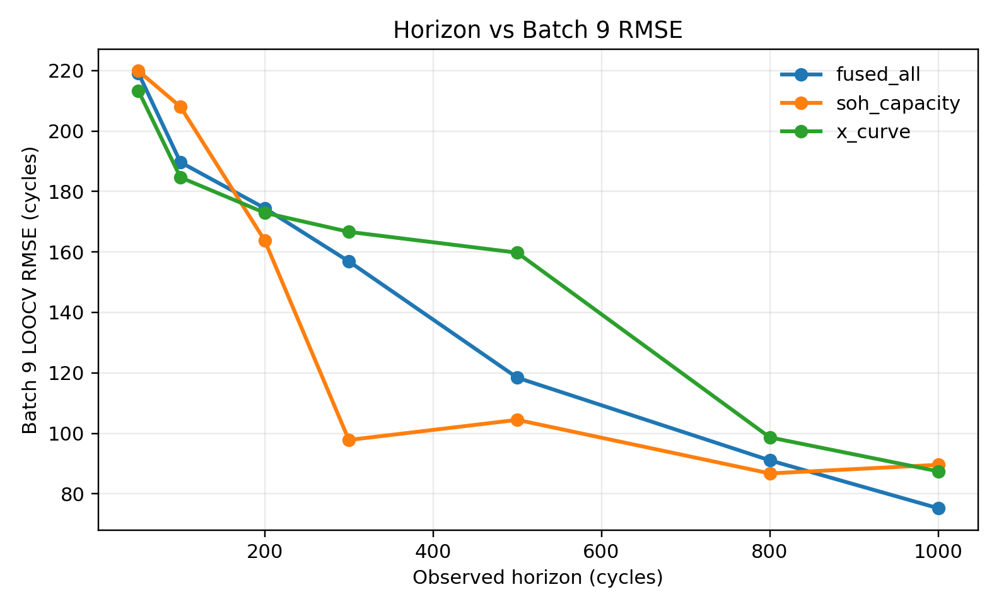
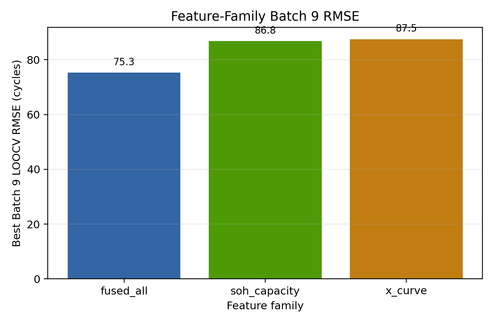
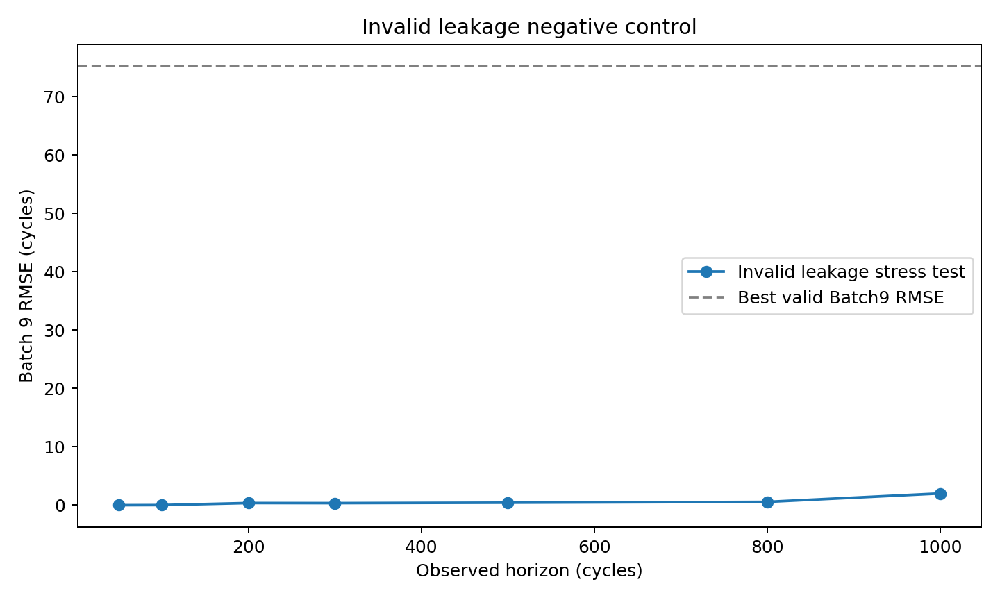
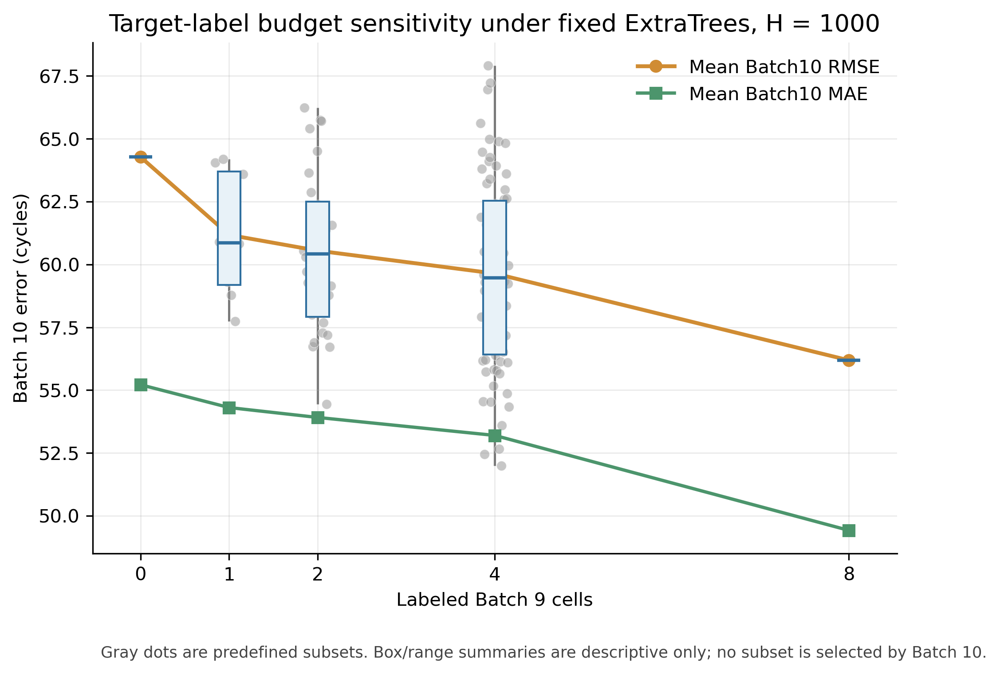
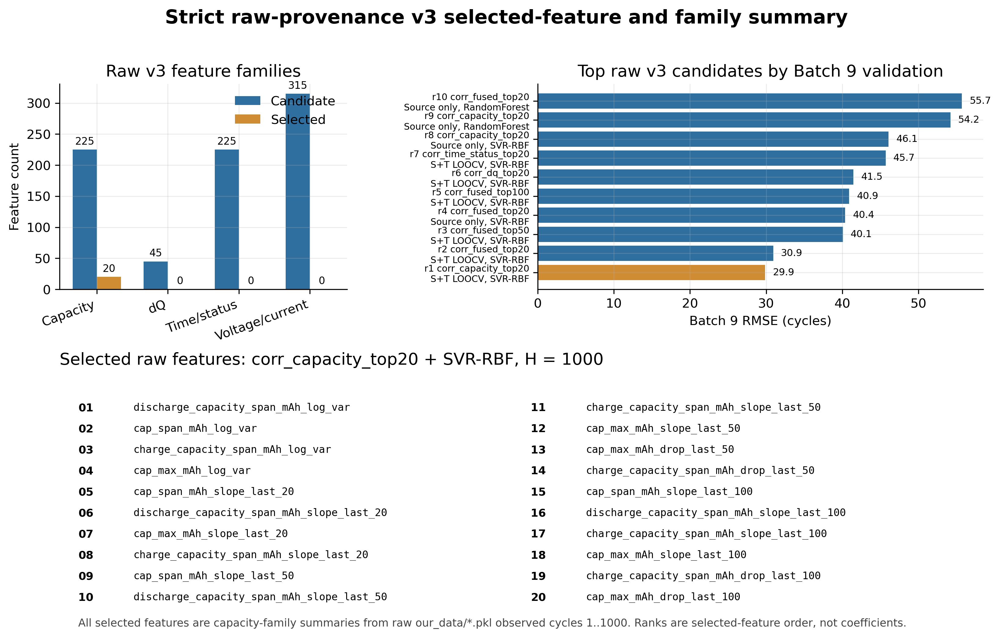

# Supplementary Materials

Protocol-clean EOL/RUL prognostics for lithium-ion batteries

## S1 Fixed protocol and leakage guard

本补充材料的目的不是新增主结果，而是对固定协议、泄漏控制、特征来源、目标域标签预算、原始数据溯源以及神经模型负向控制进行审稿防御式说明。所有定量结论均遵守固定边界：Batch 1-8 为 source domain，Batch 9 为带标签 target development/adaptation/model-selection set，Batch 10 仅作为 blind test after fixed selection 使用。

**Table S1 Fixed split and permitted use.**

| Role | Batches | Cells | Allowed use |
| --- | --- | --- | --- |
| Source domain | Batch 1-8 | 61 | Source training and source-only comparator |
| Target development/adaptation | Batch 9 | 8 | Labeled target adaptation and Batch-9-only selection |
| Blind target test | Batch 10 | 8 | Final reporting only; no training or selection |

在 EOL-first 表述下，模型首先预测 cell-level EOL cycle；当观测 horizon 固定为 h 时，RUL 由 predicted RUL = predicted EOL - h 得到。因此，在固定 horizon 的 cell-level EOL/RUL 评估中，EOL 和 RUL 的绝对误差数值相同。

## S2 Feature-family and horizon audit

该审计固定 learner 为 strict v1 的 ExtraTrees，并仅使用 Batch 9 leave-one-cell-out 验证比较 feature family 和 horizon。Batch 10 没有被该脚本加载，也没有参与特征族、horizon 或模型选择。

**Table S2 Batch9 validation-only feature-family and horizon audit.**

| Feature family | Horizon | Features | Batch9 RMSE | Batch9 MAE |
| --- | --- | --- | --- | --- |
| fused_all | 50 | 108 | 219.15 | 151.50 |
| fused_all | 100 | 108 | 189.67 | 144.64 |
| fused_all | 200 | 108 | 174.49 | 120.23 |
| fused_all | 300 | 108 | 156.88 | 104.71 |
| fused_all | 500 | 108 | 118.42 | 101.14 |
| fused_all | 800 | 108 | 91.08 | 78.14 |
| fused_all | 1000 | 108 | 75.26 | 61.96 |
| soh_capacity | 50 | 59 | 219.87 | 160.36 |
| soh_capacity | 100 | 59 | 208.02 | 165.92 |
| soh_capacity | 200 | 59 | 163.83 | 135.13 |
| soh_capacity | 300 | 59 | 97.82 | 78.97 |
| soh_capacity | 500 | 59 | 104.48 | 89.33 |
| soh_capacity | 800 | 59 | 86.76 | 70.24 |
| soh_capacity | 1000 | 59 | 89.60 | 68.81 |
| x_curve | 50 | 49 | 213.32 | 148.12 |
| x_curve | 100 | 49 | 184.66 | 140.45 |
| x_curve | 200 | 49 | 172.96 | 128.11 |
| x_curve | 300 | 49 | 166.65 | 124.56 |
| x_curve | 500 | 49 | 159.76 | 119.67 |
| x_curve | 800 | 49 | 98.68 | 80.50 |
| x_curve | 1000 | 49 | 87.46 | 84.34 |

**Fig. S1 Horizon sensitivity by feature family under Batch9 validation only.**

**Fig. S2 Best Batch9 RMSE by feature family.**

## S3 Leakage blacklist and negative control

模型输入黑名单包括 EOL/RUL 标签、全寿命长度、observed ratio、horizon、n_observed、last_observed_cycle、cell id、batch id 以及任何需要未来循环才能计算的字段。feature-horizon-leakage-defense-v2 的 audit 显示这些字段 used_as_model_input 均为 false。

**Table S3 Valid feature-family rows after leakage-negative-control QA.**

| Family | Selected horizon | Features | Batch9 RMSE | Batch10 RMSE report-only |
| --- | --- | --- | --- | --- |
| strict_fused_all | 1000 | 108 | 75.26 | 56.19 |
| soh_capacity_only | 800 | 59 | 86.76 | 138.56 |
| x_curve_only | 1000 | 49 | 87.46 | 199.74 |

**Table S4 Invalid endpoint-derived leakage stress test.**

| Horizon | Invalid Batch9 RMSE | Invalid Batch10 RMSE report-only |
| --- | --- | --- |
| 50 | 0.0002 | 0.0004 |
| 100 | 0.0199 | 0.0097 |
| 200 | 0.3714 | 0.6056 |
| 300 | 0.3556 | 0.4163 |
| 500 | 0.4326 | 0.2336 |
| 800 | 0.5717 | 0.9564 |
| 1000 | 2.0148 | 0.3158 |

**Fig. S3 Invalid endpoint-derived leakage negative control.**

## S4 Target-label budget sensitivity

目标域标签预算实验固定 ExtraTrees、1000-cycle horizon 和特征黑名单，评估 k=0/1/2/4/8 个 Batch 9 标签时的 Batch 10 结果。所有子集预先定义，不允许根据 Batch 10 选择更优子集。

**Table S5 Target-label budget aggregate sensitivity.**

| Labeled Batch 9 cells | Subsets | RMSE mean | RMSE median | RMSE range | MAE mean |
| --- | --- | --- | --- | --- | --- |
| 0 | 1 | 64.27 | 64.27 | 64.27-64.27 | 55.21 |
| 1 | 8 | 61.17 | 60.86 | 57.74-64.20 | 54.30 |
| 2 | 28 | 60.55 | 60.42 | 54.45-66.24 | 53.91 |
| 4 | 70 | 59.64 | 59.46 | 51.99-67.91 | 53.20 |
| 8 | 1 | 56.19 | 56.19 | 56.19-56.19 | 49.42 |

**Fig. S4 Target-label budget sensitivity.**

## S5 Raw provenance diagnostic

raw provenance 诊断只读取直接 raw our_data/*.pkl 输入，不使用处理后的 clean_*_x.npy、metadata 或 y_nominal 作为模型输入。该诊断用于证明部分预测信息可以从原始在线观测信号追溯得到，但其 Batch 10 结果尚未超过 strict processed-feature ExtraTrees。

**Table S6 Raw-provenance diagnostic summary.**

| Diagnostic line | Feature source | Selected strategy | Batch 9 RMSE/MAE | Batch 10 RMSE/MAE | Interpretation |
| --- | --- | --- | --- | --- | --- |
| Earlier raw-pkl/dq | Direct raw pkl and dq summaries | ElasticNet, 1000 | 52.15 / n.r. | 125.54 / 101.38 | Feasibility diagnostic; generalized poorly |
| Raw feature-selection | Raw-derived selected features | corr_fused_top20 + SVR-RBF | 30.94 / 25.56 | 76.97 / 67.46 | Feature-selection diagnostic |
| Strict raw-provenance v3 | Direct raw our_data/*.pkl only | corr_capacity_top20 + SVR-RBF | 29.87 / 21.66 | 74.12 / 63.16 | Traceability evidence |

**Fig. S5 Strict raw-provenance v3 summary.**

## S6 Neural negative controls and cubic-base ablation

Round8 进一步尝试了两个严格协议下的物理一致性神经原型。两个模型都遵守 Batch-9-only 选择协议，但均未超过 strict ExtraTrees 主结果，因此只能作为负向或诊断控制。

**Table S7 Polynomial-base ablation and neural negative-control summary.**

| Family | Protocol | Degree | Batch 9 RMSE | Batch 9 MAE | Interpretation |
| --- | --- | --- | --- | --- | --- |
| polyresid | source + target-adapt LOOCV | 3 | 114.03 | 99.82 | Best compact target-adapt neural variant |
| polyresid | source + target-adapt LOOCV | 4 | 182.94 | 151.24 | Weaker |
| polyresid | source + target-adapt LOOCV | 2 | 742.88 | 708.78 | Failed |
| base only | no training | 3 | 141.37 | 105.36 | Best base-only variant |
| base only | no training | 4 | 353.40 | 313.50 | Weaker |
| base only | no training | 2 | 1187.93 | 1147.65 | Failed |

## S7 Limitations and reproducibility notes

当前正式结论仍是 within-dataset cross-batch evidence。Batch 10 只有 8 个盲测电池，统计外推能力有限；当前最佳 horizon 为 1000 cycles，属于 early-to-mid-life，不支持 very-early 50/100-cycle 高精度声明；数据中没有温度字段，不支持 temperature-aware claim；三次基座只能写作当前数据和 compact target-adapt 设置下的低阶非线性先验，不能写作物理定律。

所有脚本均保存在 codex 对应实验目录。Round8 审查中，feature-horizon-leakage-defense-v2、leakage-negative-control-v1、physics-consistent-neural-eol-v3 和 physics-neural-eol-alt-v4 的脚本均通过 py_compile，JSON 可正常解析。
